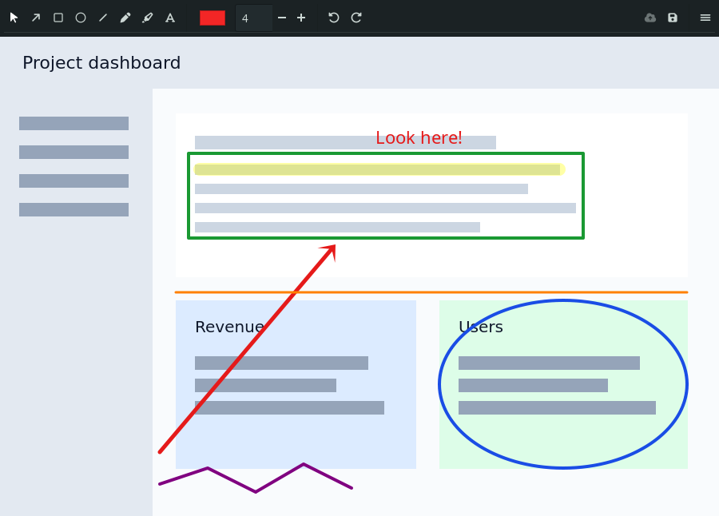
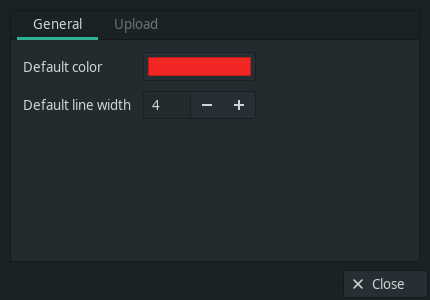

# Gannotate

[](https://github.com/arodu/gannotate/actions/workflows/tests.yml)

A lightweight screenshot annotator for Linux, built with GTK3 and Cairo.

Gannotate opens an existing capture, lets you add arrows, shapes and text, and
can hand it off to any upload command you configure.

## Features

- Arrow, rectangle, ellipse, line, pencil, highlighter and text.
- Four arrow heads (classic, triangle, slim, wide), shown as icons in Preferences.
- Color picker and line width.
- Resizable window with zoom (Ctrl+scroll, +/-, Fit, 1:1) and scrollbars;
  middle-drag or Ctrl+drag to pan.
- Select tool to move and resize annotations after adding them.
- Undo/redo and delete selected.
- Copy the annotated image to the clipboard (Ctrl+C) without closing, with
  a desktop notification.
- Save as PNG or run a configurable upload command.
- Uploads are opt-in and disabled by default; optionally keep the window
  open after uploading.
- Small dependency footprint: GTK3 + Cairo.

## Status / Limitations

Gannotate is an early 0.2.0 release.

- Linux/X11 focused; tested on XFCE. Region capture relies on `xfce4-screenshooter`.
- No Wayland/portal capture yet.
- Uploads are opt-in: configure a command in Preferences.
- No blur or step numbering yet.
- Text is single-line; annotations are flattened to a PNG.
- HiDPI and multi-monitor setups are not deeply tested.

## Requirements

- Python 3.10+
- PyGObject, GTK3 and pycairo
- Optional: `libnotify` for desktop notifications and `xfce4-screenshooter`
  for region capture

Arch / Manjaro:

```sh
sudo pacman -S python-gobject gtk3 python-cairo librsvg
```

Debian / Ubuntu:

```sh
sudo apt install python3-gi gir1.2-gtk-3.0 python3-cairo python3-gi-cairo librsvg2-common
```

## Run from source

```sh
./bin/gannotate                    # blank window; use Open Image...
./bin/gannotate path/to/image.png  # opens a specific image
```

## Install

### Debian / Ubuntu

Download `gannotate_0.2.0-1_all.deb` from the latest release and install it:

```sh
sudo apt install ./gannotate_0.2.0-1_all.deb
```

### Arch / Manjaro

Once the package is published in the AUR:

```sh
yay -S gannotate
```

Or build from the bundled `PKGBUILD`:

```sh
cd packaging
makepkg -si
```

See `packaging/README.md` for the release and AUR workflow.

### From source

```sh
sudo make install                    # /usr/local
make install PREFIX="$HOME/.local"   # user install
```

If you install to `$HOME/.local`, make sure `$HOME/.local/bin` is in your
`PATH`.

Uninstall:

```sh
sudo make uninstall
```

### Build packages

```sh
make deb   # or ./packaging/build-deb.sh
```

The `.deb` requires `dpkg-deb`; on Arch/Manjaro use Docker or the CI workflow.

## Use with XFCE

Create a custom action for `xfce4-screenshooter` with this command:

```
$HOME/labs/gannotate/bin/gannotate %f
```

After `make install`, use:

```
gannotate %f
```

Then capture a region and pick the action. `%f` is the captured image path.

## Keyboard shortcuts

| Key                    | Action                    |
|------------------------|---------------------------|
| Enter                  | Upload (if configured)    |
| Ctrl+C                 | Copy image to clipboard   |
| Ctrl+S                 | Save as...                |
| Esc                    | Cancel                    |
| Ctrl+Z                 | Undo                      |
| Ctrl+Shift+Z / Ctrl+Y  | Redo                      |
| Delete                 | Delete selected annotation |

## Upload configuration

Open the menu (hamburger) and choose **Preferences**. Set an upload command
there.

- Empty by default: uploads are disabled and the Upload button is greyed out.
- **Close window after upload** is enabled by default. Disable it to keep
  annotating after the upload; the result is shown as a desktop notification.
- `%f` is replaced by the image path. If `%f` is missing, the path is appended
  as the last argument.
- The command is split into arguments (no shell pipes), for example:

```
/home/you/.local/bin/share-to-imgur.sh %f
```

If the command fails, the image is saved to `~/Pictures/Screenshots` instead of
being lost. Configuration lives in `~/.config/gannotate/config.json`.

## Development

```sh
make test
```

Tests cover geometry, rendering and the GTK UI. UI tests use Xvfb in CI.

## Project layout

```
bin/gannotate              launcher for the source tree
data/gannotate.desktop     desktop entry
packaging/build-deb.sh     Debian package builder
packaging/PKGBUILD         Arch/AUR package recipe
src/gannotate/app.py       GTK window and interactions
src/gannotate/model.py     annotation geometry (pure, testable)
src/gannotate/render.py    Cairo rendering
src/gannotate/config.py    config file handling
src/gannotate/notify.py    desktop notifications
src/gannotate/upload.py    upload command runner
src/gannotate/__main__.py  CLI entry point
```

## Screenshots





## Credits

Created by [arodu](https://github.com/arodu).

The icon set is original to Gannotate and is covered by the project
license.

## License

GNU General Public License v3.0 (GPL-3.0).
